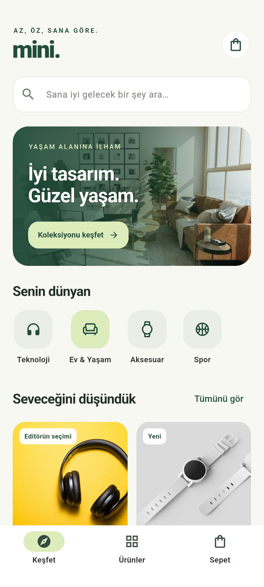
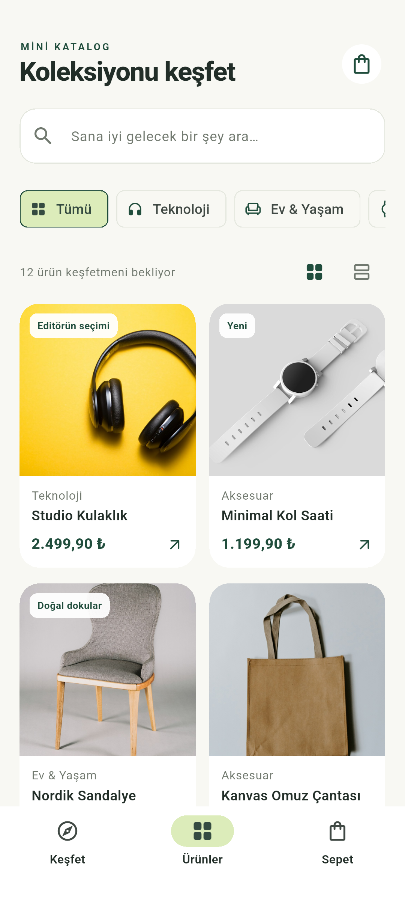
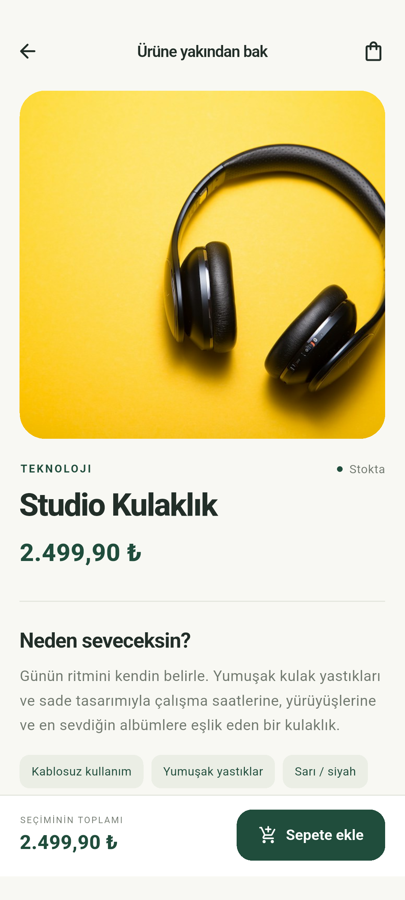
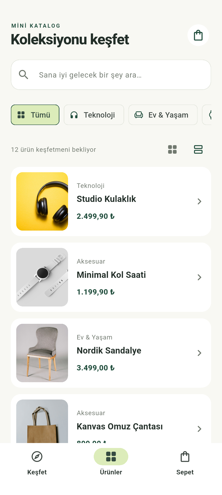
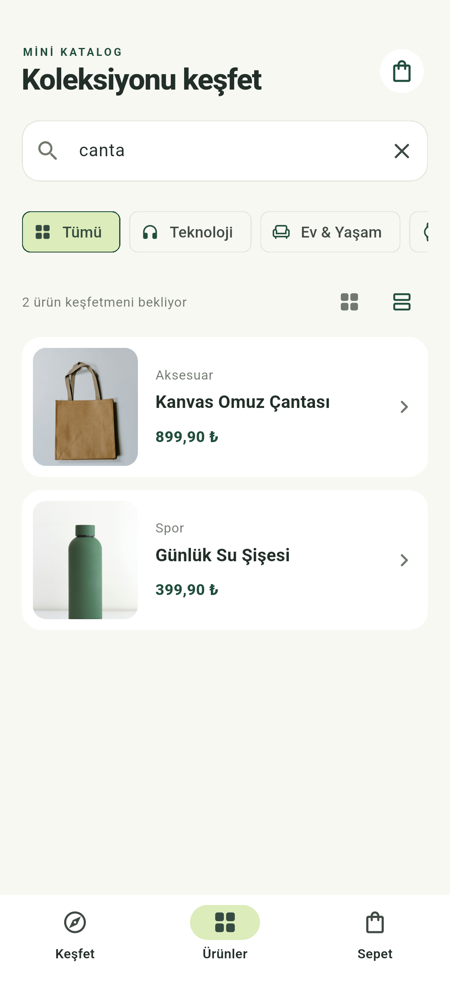
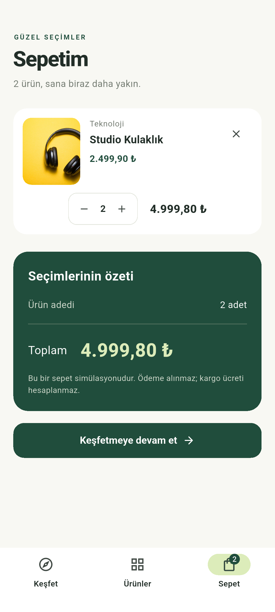

# Flutter Mini Katalog

**Mini Katalog**, Flutter ve Dart ile hazırlanmış, Türkçe arayüzlü bir mobil ürün kataloğudur. Yerel JSON dosyasından yüklenen 12 ürünü keşfetmeyi, arama ve kategori filtrelerini kullanmayı, ürün detaylarını incelemeyi ve basit bir sepet simülasyonu yapmayı sağlar.

Uygulama ürünleri ve fotoğrafları yerel assets dosyalarından okur; kullanım sırasında internet bağlantısı gerekmez. Gerçek ödeme, üyelik veya sipariş servisi içermez.

## Kullanılan sürümler ve teknolojiler

- **Flutter 3.50.0 — stable**
- **Dart 3.14.0**
- Material Design 3; bu Flutter sürümünün Material bileşenleri için `material_ui` paketi (kilitli sürüm: 1.11.0)
- `StatefulWidget` ve `setState` ile durum yönetimi
- `Navigator.push/pop` ve `MaterialPageRoute` ile sayfa geçişleri
- `GridView.builder`, `ListView.builder`, `LayoutBuilder` ve kaydırılabilir ekranlar
- `Product.fromJson/toJson`, `dart:convert` ve `rootBundle`
- Flutter SDK içindeki `flutter_test` ve `integration_test`

Ayrı bir durum yönetimi, HTTP, resim önbelleği veya ödeme paketi kullanılmaz. `pubspec.lock` dosyası sürüm kontrolüne dahil edilmelidir.

## Özellikler

- Banner, çalışan koleksiyon bağlantısı, kategoriler ve öne çıkan ürünlerle ana sayfa.
- Teknoloji, Ev & Yaşam, Aksesuar ve Spor kategorilerinde 12 örnek ürün.
- Izgara/liste görünümü arasında geçiş.
- Türkçe harfleri ve büyük/küçük harfi tolere eden arama (`canta` → `Çanta`). Arama ve kategori filtresi birlikte uygulanır.
- Ürün nesnesinin detay sayfasına aktarılması; görsel, açıklama, özellik, fiyat ve adet seçimi.
- Aynı ürünün sepette birleştirilmesi; adet artırma/azaltma, kaldırma, toplam adet ve fiyat hesabı.
- Stok sınırı kontrolü; tükenmiş ürünlerin eklenememesi.
- Boş arama, boş sepet ve yükleme hatası/yeniden deneme durumları.
- Dar ekran, tablet, yatay ekran ve büyük sistem yazısı için uyarlanabilir yerleşim.

Fiyatlar yuvarlama hatası oluşmaması için **tam sayı kuruş** olarak tutulur. Örneğin `249990`, `2.499,90 ₺` şeklinde gösterilir. Sepet yalnızca uygulama oturumu boyunca bellekte tutulur; uygulama yeniden başlatıldığında sıfırlanır. Stok ve ürün bilgileri örnek verilerdir.

## Kurulum ve çalıştırma

1. Flutter 3.50.0 veya uyumlu bir kararlı sürüm kurun. Android SDK, uygun JDK ve bir Android cihaz/emülatör hazırlayın.
2. Bu depoyu indirin veya klonlayın ve `pubspec.yaml` dosyasının bulunduğu proje kökünü açın.
3. Terminalde çalıştırın:

```sh
flutter doctor -v
flutter pub get
flutter devices
flutter run -d <android-cihaz-kimligi>
```

Android emülatörlerini listelemek ve başlatmak için:

```sh
flutter emulators
flutter emulators --launch <emulator-adi>
```

Yerel doğrulamada Android 16 / API 36, x86_64 sistem imajı ve `mini_katalog_api36` emülatörü kullanılmıştır. Kurulum yolları başka bilgisayarlarda farklı olabilir; kişisel `android/local.properties` dosyası Git'e eklenmez.

## Test ve APK doğrulaması

```sh
flutter analyze
flutter test
flutter build apk --debug
```

Standart APK çıktısı: `build/app/outputs/flutter-apk/app-debug.apk`.

Testler JSON dönüşümünü, hatalı verileri, yerel assets dosyalarını, Türkçe aramayı, kategori filtrelerini, gezinmeyi, stok sınırlarını, sepet miktarlarını, kesin fiyat hesabını ve farklı ekran boyutlarını doğrular. Widget testleri **320×640**, **390×844**, **800×1024**, **640×360** ve **360×800 / 2× yazı ölçeği** koşullarını kapsar.

Gerçek Android cihaz/emülatör üzerinde akışı test etmek ve ekran görüntülerini yeniden oluşturmak için:

```sh
flutter drive --driver=test_driver/integration_test.dart --target=integration_test/catalog_flow_test.dart -d <android-cihaz-kimligi>
```

Bu komut uygulamanın test sürümünü cihaza yükler. Sonrasında normal uygulamaya dönmek için `flutter run` kullanın. Ekran görüntüleri çalışan uygulamadan `integration_test` aracılığıyla alınır; tasarım maketi veya yapay görsel değildir.

### Doğrulama sonuçları — 15 Kasım 2026

| Kontrol | Sonuç |
| --- | --- |
| `flutter doctor -v` | Sorun bulunmadı; Android araç zinciri ve lisanslar hazır |
| `flutter analyze` | Hata veya uyarı yok |
| `flutter test` | 18 test başarılı: 6 veri/model, 12 widget senaryosu |
| Android uçtan uca test | Ana sayfa, ızgara/liste, arama, kategori, detay ve sepet akışı başarılı |
| `flutter build apk --debug --target lib/main.dart` | Normal uygulama APK'sı başarıyla derlendi |
| APK kurulumu ve açılışı | API 36 emülatöründe `Success` / `Status: ok`; ana sayfa doğrulandı |
| Ekran görüntüleri | 8 entegrasyon testi görüntüsü ve normal APK'dan 1 tam Android ekranı |

Testler stok sınırını aşmayı ve stokta olmayan ürün eklemeyi engellediğini doğrular. Emülatör senaryosu, iki kulaklık için **4.999,80 ₺**, adet üçe çıkarıldığında **7.499,70 ₺** toplamını ve ürün kaldırıldığında boş sepeti kontrol eder.

Emülatör kontrolü sırasında Android System UI için bir yanıt vermeme uyarısı görüldü. Kayıtlar System UI ve klavye süreçlerini işaret ediyordu. Gradle arka plan süreci durdurulduktan ve bekleme seçildikten sonra normal uygulama ekranı tekrar doğrulandı; uygulamanın AndroidRuntime/Flutter hata kaydı boştu. Bu doğrulama Android emülatörünü kapsar; fiziksel cihaz ve iOS testi yapılmadı.

## Gerçek uygulama ekran görüntüleri

| Ana sayfa | Ürün listesi | Ürün detay |
| --- | --- | --- |
|  |  |  |

| Liste görünümü | Arama | Sepet |
| --- | --- | --- |
|  |  |  |

Diğer görüntüler: [Kategori filtresi](screenshots/05-kategori.png), [Boş sepet](screenshots/08-bos-sepet.png).

[Normal APK'nın Android sistem çubuklarıyla tam ekran görüntüsü](screenshots/09-normal-apk-ana-sayfa.png) ayrıca ADB `screencap` ile alınmıştır. Görüntülerin kaynağı ve yeniden üretim bilgisi [screenshots/README.md](screenshots/README.md) dosyasındadır.

## Proje yapısı

```text
lib/
  main.dart                      # Uygulama ve Türkçe yerelleştirme
  data/catalog_repository.dart   # JSON yükleme, arama ve fiyat biçimlendirme
  models/product.dart            # fromJson / toJson
  models/cart_item.dart          # Ürün, miktar ve satır toplamı
  screens/catalog_shell.dart     # Ana sayfa, katalog ve setState ile sepet durumu
  screens/product_detail_screen.dart
  screens/cart_screen.dart
  widgets/catalog_widgets.dart   # Kartlar, liste satırı ve adet kontrolü
  theme/app_theme.dart           # Material tema
assets/data/products.json
assets/images/                   # 12 ürün fotoğrafı ve banner
screenshots/                     # Emülatörden gerçek PNG görüntüleri
test/                            # Model ve widget testleri
integration_test/                # Gerçek Android akış testi
test_driver/                     # Ekran görüntülerini diske yazan sürücü
```

## Teslim yönergesiyle eşleşme

| İstenen | Projedeki karşılığı |
| --- | --- |
| Flutter ve Dart | `lib/`, `pubspec.yaml` |
| Ürün listeleme | Izgara ve liste görünümü, yerel 12 ürün |
| Detay ve Navigator geçişleri | `ProductDetailScreen`, `MaterialPageRoute`, ürün nesnesi aktarımı |
| JSON veri modeli | `Product.fromJson/toJson`, `assets/data/products.json` |
| Basit sepet | `StatefulWidget`, `setState`, adet ve toplam hesaplama |
| Proje adı, açıklama, Flutter sürümü, kurulum | Bu README'nin ilgili bölümleri |
| Gerçek ana sayfa, liste ve detay görüntüleri | `screenshots/` |
| Public GitHub deposu | Yerel hazırlık tamamlandı; kullanıcı onayıyla paylaşılacak, henüz yüklenmedi |

APK öğretmenin ayrı teslim şartı değildir; yalnızca Android üzerinde derlenebilirliği doğrulamak için üretilir. Public depo oluştururken **yalnızca bu proje klasörünü depo kökü olarak kullanın**; diğer projeleri içeren üst TNC klasörünü yüklemeyin. GitHub'a yükleme/push bu çalışma kapsamında yapılmamıştır.

Seçilen üç temel teslim görseli, GitHub'a dahil edilecek dosyalar ve son kontrol özeti [TESLIM.md](TESLIM.md) dosyasındadır.

## Görsel kaynakları

Ürün ve banner fotoğrafları Unsplash kaynaklıdır. Kaynak kimlikleri ve kullanım açıklaması [assets/images/README.md](assets/images/README.md) ve [sources.json](assets/images/sources.json) dosyalarındadır. Fotoğraflarda görülebilen markalarla ilişki yoktur; örnek fiyatlar gerçek satış teklifi değildir.
